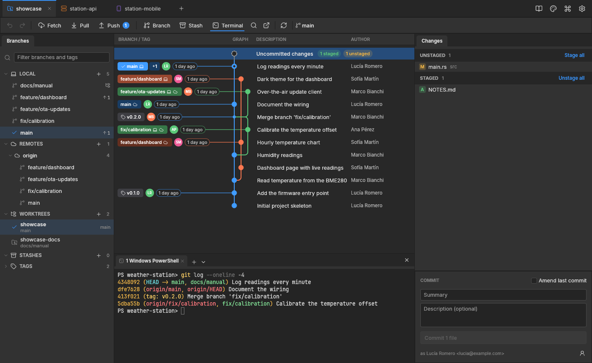

# gitcraft

A visual git client: a simplified yet powerful take on the usual graph-based git GUIs.
Rust + [egui/eframe](https://github.com/emilk/egui), the same technical stack of the ArtCraft suite, so it builds on Windows, Linux and macOS and stays light and fast. It drives the installed `git` command line,
so your config, credentials and hooks apply as usual.



## Features

**Repositories and tabs**

- Start page: checks that `git` is installed; open, create (`git init`) or clone a repository;
  recent repositories.
- Browser-like tabs, one per repository (Ctrl+T, Ctrl+W, middle-click). Open tabs, recents,
  theme and settings are remembered.
- Changes made elsewhere (editor, terminal) show up by themselves: the folder is watched.

**Graph**

- Every branch, coloured lanes, ↑/↓ to move. History loads 1500 commits at a time as you scroll.
- Branch and tag pills in their own column left of the graph, on each branch's tip only, joined
  to their commit: white text, a laptop icon when the branch is local, a cloud when a remote has
  it at that commit (`x` and `origin/x` make one pill), a pull-request icon when one is open,
  `+N` when more refs share the commit, the author's avatar and how long ago it was ("2 hours
  ago"). Author, date and hash columns are optional (Settings).
- The checked-out branch's pill is solid, the others a darker shade. Double-click a pill to
  check that branch (or tag) out; hover `+N` to list every pill of the commit and double-click
  the one you want.
- Each commit's summary, followed by the rest of its message, faded and cut to fit.
- An _Uncommitted changes_ row on top while the working tree is dirty.
- Search (Ctrl+F) through messages, authors and hashes of all history, or switch to _Code_ to
  find the commits that added or removed a piece of text in a file (`git log -S`); Enter /
  Shift+Enter jump between results, loading older history when needed.
- Right-click a commit: create a branch or a tag, check it out, interactive rebase onto it,
  cherry-pick, revert, reset the current branch to it (soft / mixed / hard, confirmed), the menu
  of each branch on it, copy the hash, message or branch name. Right-click a branch's pill to get
  check out, fast-forward, merge, rebase and interactive rebase for that branch on top.
- Compare: Ctrl+click a second commit (or _Compare with…_ in the commit menu, the changes row
  standing for the working tree) to list the files that differ between the two and open each
  diff. On a branch, _Changes x adds to main_ shows only what it changed since the two diverged,
  as a pull request shows it, and _Compare main with x_ every difference; a checkbox switches
  between the two. The right pane says how many commits each side has that the other hasn't.
- Interactive rebase: the commits to rewrite, newest on top; pick, reword (edit the message in
  place), squash, fix up or drop each one, move them up and down, then _Start rebase_. Ctrl+Z
  undoes it.

**Branches, remotes, worktrees, stashes, tags** (left)

- Local branches with ahead/behind; right-click: check out (or in a new worktree), fast-forward,
  merge into / (interactively) rebase onto the current branch, push, create a pull request,
  rename, delete…
- Remotes: add, edit (name and URL), fetch one, remove; their branches below each.
- Worktrees: add (existing or new branch), open in a tab, open a terminal there, lock, remove,
  prune.
- Stashes: stash (with a message, untracked files included), see what a stash holds, apply, pop,
  drop.
- Pull / merge requests of GitHub (through `gh`) or GitLab (through `glab`): list, open in the
  browser, check out, create from a branch.
- Tags: create (light or annotated, optionally pushed), push, delete locally or on the remote.

**Changes and commits** (right)

- Conflicted / unstaged / staged lists with stage, unstage, discard and mark-resolved buttons,
  _Stage all_ / _Unstage all_; right-click a file to open it, open it in your editor, show it in
  its folder, see its history or blame, or ignore it (the file, its extension or its folder go
  into `.gitignore`; a tracked file stops being tracked).
- Part of a file: _Stage hunk_, _Discard hunk_ and _Unstage hunk_ on each hunk of its diff, or
  click the changed lines you want (Shift+click for a range) and stage, unstage or discard only
  those. Discarding can be undone with Ctrl+Z.
- Commit box (Ctrl+Enter; with nothing staged it stages everything), _Amend last commit_
  (warns when the commit is already pushed), the identity you commit as, and saved identities to
  switch a repository to.
- Undo / redo (Ctrl+Z / Ctrl+Y) of commits, amends, merges, rebases, pulls, resets,
  cherry-picks, reverts, checkouts, branch create / rename / delete, tags and stashes.

**Diffs and conflicts** (centre)

- Unified or side by side, syntax colours, the changed part of each line marked, whitespace
  changes optional, images shown before / after. Esc closes.
- Code takes the colours of the theme VS Code (or Insiders, VSCodium) is using, read from its
  settings and extensions, when it is dark or light like gitcraft's; a setting turns it off.
- Conflicts open in a three-pane editor: each conflict's two sides with _Ours_, _Theirs_ and
  _Both_ buttons, and the result below (editable). _Use mine_ / _Use theirs_ for a whole file.
- A merge, rebase, cherry-pick or revert stopped on conflicts shows a banner with _Abort_; the
  commit box finishes it (_Continue rebase_ during a rebase).
- File history (every commit that changed the file, following renames; click one for its diff)
  and blame (who last changed each line, newer changes marked brighter; click to go to the
  commit).

**Toolbar, terminal, app**

- Undo, redo, Fetch, Pull and Push (with incoming / outgoing counts), new branch, stash, terminal,
  search, open the folder (Explorer / Finder, your editor), refresh (F5).
- Background fetch every few minutes (Settings; 0 turns it off).
- HTTPS sign-in: when a remote wants a username and password (or token) and no credential helper
  provides them, a dialog asks and the operation runs again. They stay in memory for the tab;
  git's own credential helper, if there is one, stores them. Cloning asks the same way.
- Terminal panel with tabs: PowerShell, cmd, Git Bash, WSL… on Windows, your shells elsewhere, in a
  real pseudo-terminal (ConPTY on Windows) with colours, scrollback, mouse selection and copy
  (Ctrl+C with a selection, Ctrl+Shift+C or right-click).
- Command palette (Ctrl+P): every action and branch, fuzzy matched.
- Manual (F1, or the book in the title bar): what each part does and every keyboard shortcut.
- Avatars: on a GitHub repository, the authors' GitHub accounts (through `gh` when installed, else
  GitHub's API); on GitLab, the host's avatar API; elsewhere Gravatar (a hash of the email).
  Cached on disk; can be turned off.
- Settings: zoom, branch column width, graph columns, avatars, notifications, update check,
  background fetch, editor command, default shell and terminal font size, saved identities.
- Checks GitHub every 12 hours for a newer release and shows a pill to download it (can be turned
  off).
- Toasts, and a desktop notification when a long operation ends while the window is in the
  background.
- Themes: Dark, Medium Gray and Light, from PhotoCraft's Pro palettes.

## Download

Ready-made builds for Windows, Linux (x86-64) and macOS (Apple silicon and Intel) are on the
[releases page](https://github.com/Vancete/gitcraft/releases). Git must be installed.

- **Windows:** `gitcraft-…-setup.exe` installs it for your user (no administrator rights), with a
  Start menu entry, an optional desktop icon, _Open in gitcraft_ on folders and an uninstaller.
  The `.zip` is the same program without installing.
- **Linux:** `gitcraft-….deb` (Debian, Ubuntu, Mint…) and `gitcraft-….rpm` (Fedora, openSUSE…)
  install it with its applications menu entry, from the software centre or with
  `sudo apt install ./gitcraft-….deb` / `sudo dnf install ./gitcraft-….rpm`.
  `gitcraft-….AppImage` runs on any distribution: make it executable (`chmod +x`) and run it;
  _Add gitcraft to the applications menu_ on its start page (or in Settings) adds a menu entry,
  which follows the AppImage when you replace it with a newer one. The `.tar.gz` holds the bare
  binary and a `.desktop` file.
- **macOS** (11 or later): open `gitcraft-…-macos-universal.dmg` and drag gitcraft to
  Applications; the `.zip` holds the same app. It isn't notarized by Apple, so the first time
  macOS refuses to open it: go to _System Settings › Privacy & Security_ and click _Open
  Anyway_, or run `xattr -dr com.apple.quarantine /Applications/gitcraft.app`. git comes with
  the Xcode command line tools (`xcode-select --install`) or Homebrew.

A release is built by `.github/workflows/release.yml` whenever a `v*` tag is pushed
(`packaging/windows/gitcraft.iss` for the installer, `packaging/linux/build-appimage.sh` for the
AppImage, `[package.metadata.deb]` / `[package.metadata.generate-rpm]` in `Cargo.toml` for the
packages, `packaging/macos/build-app.sh` for the universal app, its `.dmg` and `.zip`).

## Build and run

```bash
cargo run --release                   # start
cargo run --release -- path/to/repo   # open a repository directly
cargo test
```

Linux needs the usual eframe system packages (e.g. `libxkbcommon-dev`, `libgtk-3-dev` for the
file dialogs, `libdbus-1-dev` for notifications). Pull requests need the GitHub CLI (`gh`) or
GitLab CLI (`glab`), logged in.

### Looking at the UI headlessly

`examples/ui_shot.rs` drives the app without a window (egui_kittest) and saves PNGs:

```bash
cargo run --example ui_shot -- path/to/repo /tmp/shot click:500,266 shot key:Escape shot
```

Steps: `click:x,y`, `dclick:x,y`, `rclick:x,y`, `cclick:x,y` (with Ctrl / Cmd), `sclick:x,y`
(with Shift), `drag:x1,y1,x2,y2`, `hover:x,y`, `wheel:x,y,dy` (negative scrolls down), `leave`,
`open:path` (another repository in a new tab),
`key:Name`, `ckey:Name` (with Ctrl / Cmd), `type:text`, `wait:ms`, `shot`. The README screenshot
was made this way, on a demo repository.

## Layout

| File                     | Job                                                                                |
| ------------------------ | ---------------------------------------------------------------------------------- |
| `src/git.rs`             | `git` CLI wrapper and output parsing (refs, log, status, stashes, remotes, search) |
| `src/graph.rs`           | lane layout for the commit graph                                                   |
| `src/forge.rs`           | pull / merge requests through `gh` and `glab`                                      |
| `src/avatars.rs`         | avatars from GitHub, GitLab or Gravatar, cached on disk                            |
| `src/update.rs`          | new-release check                                                                  |
| `src/desktop_entry.rs`   | applications menu entry for the AppImage                                           |
| `src/shell_path.rs`      | on macOS, the login shell's PATH for the commands gitcraft starts                  |
| `src/settings.rs`        | user settings and their form                                                       |
| `src/manual.rs`          | the manual (F1): features and keyboard shortcuts                                   |
| `src/theme.rs`           | colour tokens, fonts, egui style (PhotoCraft's Pro themes)                         |
| `src/icons.rs`           | embedded Lucide SVG icons, tinted                                                  |
| `src/terminal.rs`        | integrated terminal: pty, VT parsing (`vt100`), painting, keys, selection          |
| `src/repo/mod.rs`        | one repository tab: state, background git work, undo / redo, toolbar               |
| `src/repo/sidebar.rs`    | branches, remotes, worktrees, stashes, pull requests, tags                         |
| `src/repo/graph_view.rs` | commit graph, pills, search bar, commit menu                                       |
| `src/repo/detail.rs`     | commit / stash detail, changes and commit box                                      |
| `src/repo/diff.rs`       | diff loading, pairing and the diff view (unified, split, images)                   |
| `src/repo/highlight.rs`  | syntax colours (syntect)                                                           |
| `src/vscode_theme.rs`    | VS Code's current colour theme as a syntect theme                                  |
| `src/repo/conflict.rs`   | three-pane conflict editor                                                         |
| `src/repo/rebase.rs`     | interactive rebase editor and its todo list                                        |
| `src/repo/file_view.rs`  | a file's history and blame                                                         |
| `src/repo/dialogs.rs`    | branch, tag, stash, remote, worktree, pull request and confirm dialogs             |
| `src/repo/widgets.rs`    | shared painted widgets (panel headers, file rows, avatars, tabs)                   |
| `src/app.rs`             | window shell: tabs, start page, cloning, palette, settings, toasts                 |

Assets and their licences: [ATTRIBUTION.md](ATTRIBUTION.md).

## License

MIT OR Apache-2.0, at your option ([LICENSE-MIT](LICENSE-MIT), [LICENSE-APACHE](LICENSE-APACHE)).
